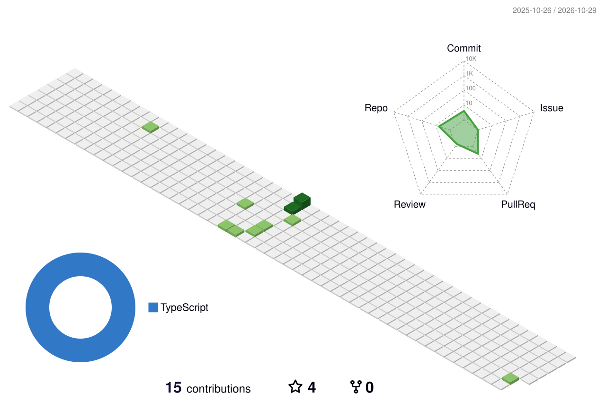

<picture>
  <source media="(prefers-color-scheme: dark)" srcset="assets/hero-dark.svg">
  
</picture>

  

### What I work on

- Backend services in Go and Node.js (NestJS), event-driven with NATS and Kafka
- On-chain data on EVM and Solana (go-ethereum, ethers.js, @solana/web3.js, Anchor)
- Fullstack web apps with Next.js (App Router) and React
- AI-native development: Claude Code and Cursor, steered with OpenSpec, bmad, Superpowers, and Matt Pocock's skills

### Public repos worth a look

- [ai-md](https://github.com/ngocgiang99/ai-md): `mdview`, one markdown file that shows humans a curated summary and gives AI agents the full content
- [Raydium-v2-example](https://github.com/ngocgiang99/Raydium-v2-example): a Raydium v2 swap example on Solana in TypeScript
- [Competitive-Programming](https://github.com/ngocgiang99/Competitive-Programming): C++ solutions to VOI 2021 problems

### Contact

giangtn99.dev@gmail.com

<picture>
  <source media="(prefers-color-scheme: dark)" srcset="profile-3d-contrib/profile-night-green.svg">
  
</picture>
